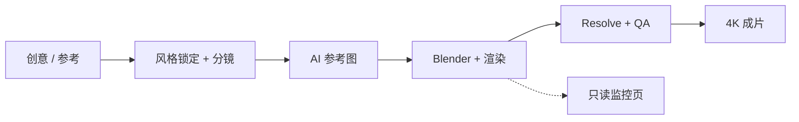
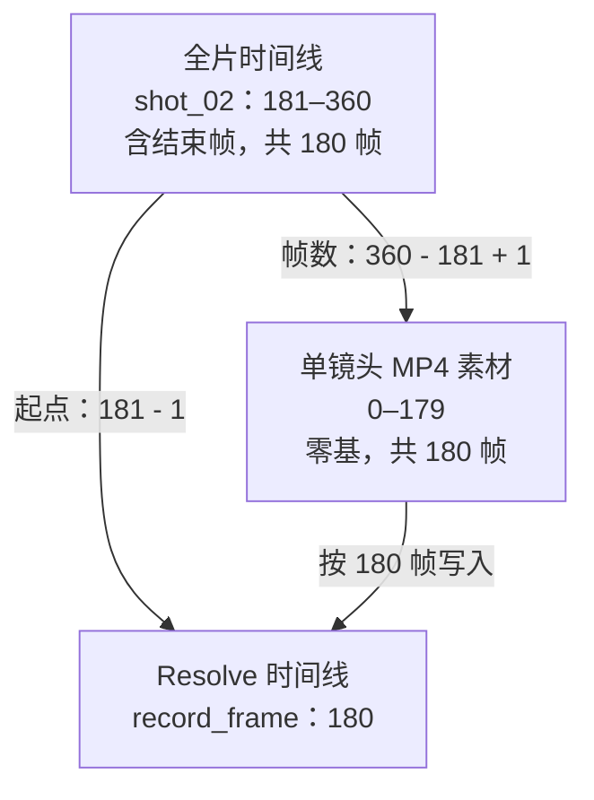
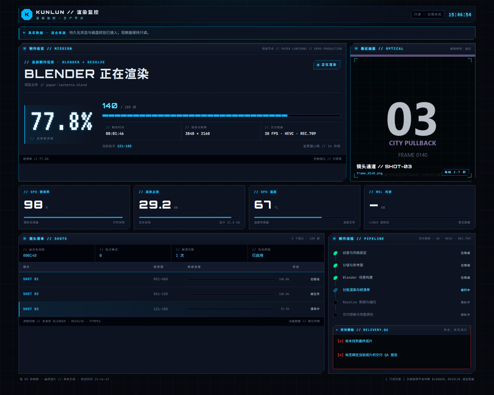

# Create Blender Story Video

给 Codex、Claude Code 和 Qoder 使用的 3D 视频制作 Skill。把一句创意或既有视觉参考推进为风格锁定、分镜、AI 参考图、Blender 场景、可恢复渲染、只读进度页、DaVinci Resolve 剪辑，以及绑定当前文件 SHA-256 的成片 QA。

An Agent Skill for creating or resuming a Blender film with schema-backed production state, resilient rendering, optional read-only monitoring, DaVinci Resolve editing, and hash-bound final media verification.

**目录：** [生产管线](#生产管线) · [默认交付](#默认交付) · [可执行能力](#这次包含的可执行能力) · [安装](#安装-skill) · [三种创作模式](#三种创作模式) · [生产工具](#生产工具) · [帧号契约](#帧号契约) · [只读监控页](#只读监控页) · [测试](#测试) · [边界](#边界)

## 生产管线



每一步都有对应的脚本和校验门禁。渲染中断后从当前帧继续，最终“完成”必须由帧序列、媒体探测和 SHA-256 共同证明。

## 默认交付

- 竖屏 2160×3840，横屏 3840×2160；用户批准的其他规格由 storyboard 统一派生
- 30 fps，支持显式分数帧率，例如 `30000/1001`
- H.265/HEVC Main、`yuv420p`、有限范围 Rec.709、MP4 `hvc1`
- 正式渲染使用原生 4K；经批准的 2× 放大路线标记为 `upscaled_4k`
- 正式帧先写 PNG，再编码镜头和最终 MP4，不直接渲染成视频

## 这次包含的可执行能力

不只是流程提示词，Skill 还附带：

- 5 份版本化 JSON Schema：storyboard、shot-status、render-state、resolve-run、delivery-report
- storyboard 与跨文件状态校验器
- 单实例 Blender 渲染监督器和 PowerShell 启动入口
- Blender 内临时帧渲染、完整 PNG 校验和原子提交
- 参数化 H.264/H.265 编码与显式输入色彩转换
- 全片媒体探测、解码和 SHA-256 绑定的 QA 报告
- 防止旧 QA、无成片 complete、重复缓存问题、缺失心跳和 DNS rebinding 的只读监控服务
- Python、Node 和真实 FFmpeg 媒体集成测试

## 支持环境

| 能力 | 支持情况 |
| --- | --- |
| 正式断点渲染监督器 | Windows + PowerShell |
| JSON 校验、帧验证、编码、媒体 QA | Python 3.11+，Windows/Linux/macOS；CI 覆盖 Ubuntu |
| 只读监控 | Python 3.11+；Pillow 可选，用于最近帧预览 |
| Blender GUI 制作 | Blender + 已配置的 Blender MCP |
| 剪辑 | DaVinci Resolve MCP 或官方 Lua/Python 脚本 API |

其他平台上的正式渲染恢复尚未验证，不能仅凭脚本可启动就宣称支持。

FFmpeg 需要 `libx264`、`libx265`；sRGB PNG 到 Rec.709 的实际转换需要 `zscale`：

```bash
ffmpeg -hide_banner -h filter=zscale
ffmpeg -hide_banner -encoders
```

## 安装 Skill

### Codex

```bash
python ~/.codex/skills/.system/skill-installer/scripts/install-skill-from-github.py \
  --repo yoruuuchan/create-blender-story-video \
  --path skills/create-blender-story-video
```

下一轮对话中调用：

```text
$create-blender-story-video
```

### Claude Code

```bash
git clone https://github.com/yoruuuchan/create-blender-story-video.git
mkdir -p ~/.claude/skills
cp -R create-blender-story-video/skills/create-blender-story-video \
  ~/.claude/skills/create-blender-story-video
```

调用：

```text
/create-blender-story-video
```

### Qoder

把 `skills/create-blender-story-video/` 复制到用户级 `.qoder/skills/` 或项目级 `.qoder/skills/`，重载 Skills 后调用 `/create-blender-story-video`。

安装 Python 校验依赖：

```bash
python -m pip install -r /path/to/skill/scripts/requirements.txt
```

监控最近帧预览是可选能力，需要时另装 Pillow：

```bash
python -m pip install Pillow
```

## 三种创作模式

1. **自主创作 `autonomous`**：用户明确授权后连续推进，记录创作和工程取舍。
2. **共同创作 `co_create`**：默认模式，在风格与分镜、参考图、Blender 预览三个确认点暂停。
3. **参考复刻 `reference_rebuild`**：拆解参考的视觉语言，不复制无授权资产；默认沿用共同创作确认行为。

模式只控制谁做创作决定，不降低技术验收标准。已有 `.blend`、分镜、参考图、镜头视频或 Resolve 工程时先校验并恢复，不从头重建。

## 生产工具

下文的 `/path/to/skill` 指安装后的 Skill 目录，`/path/to/project` 指视频项目根目录。

### 1. 校验项目契约

```bash
python /path/to/skill/scripts/validate_project.py --project-root /path/to/project
```

检查 JSON Schema、连续全片帧号、素材入出点、Resolve `record_frame`、镜头 ID 和跨文件一致性。

### 2. 正式渲染与恢复

```bash
python /path/to/skill/scripts/render_supervisor.py \
  --project-root /path/to/project --blender /path/to/blender
```

Windows 也可使用：

```powershell
& /path/to/skill/scripts/resume-render.ps1 -ProjectRoot /path/to/project -Blender /path/to/blender.exe
```

监督器提供：

- 单实例锁，避免两个监督器同时写项目
- approved `.blend` 和 storyboard SHA-256 检查
- 分批启动独立 Blender 进程，独立 stdout/stderr 日志
- 周期心跳、最近帧进度和最近 20 个帧耗时样本
- 批次重试、动态超时、冷却和自动续跑预算
- 临时 PNG 完整校验后原子提交，损坏帧隔离
- 旧活动 PID 存活时安全停止，不终止无法确认归属的进程

完整验证帧序列并写入 `frames_validated`：

```bash
python /path/to/skill/scripts/verify_frames.py \
  --project-root /path/to/project --update-status
```

### 3. 编码镜头与最终成片

```bash
python /path/to/skill/scripts/encode_media.py shot \
  --project-root /path/to/project --shot-id shot_01
```

Resolve 导出母版后，按母版真实色彩属性编码：

```bash
python /path/to/skill/scripts/encode_media.py final \
  --project-root /path/to/project --master /path/to/edit-master.mov \
  --input-primaries bt709 --input-transfer bt709 \
  --input-matrix bt709 --input-range tv
```

编码器默认拒绝覆盖已有镜头或成片；只有明确确认后才使用 `--replace`。`--dry-run` 可输出参数数组检查命令。

### 4. 最终 QA

```bash
python /path/to/skill/scripts/verify_media.py --project-root /path/to/project
python /path/to/skill/scripts/validate_project.py --project-root /path/to/project
```

`delivery/delivery-report.json` 绑定 storyboard 哈希、成片路径、文件身份、当前媒体探测、平均帧率、各流时长、全片解码和 SHA-256，并验证 QA 前后文件未变化。成片被替换后，监控页会重算哈希并使旧报告失效。

## 帧号契约

| 字段 | 用途 |
| --- | --- |
| `timeline_frame_start/end` | 全片一基、包含结束帧的连续范围，也用于 PNG 文件名 |
| `source_frame_start/end` | 编码后单镜头 MP4 的零基素材范围 |
| `record_frame` | Resolve 零基时间线写入位置，等于 `timeline_frame_start - 1` |
| `duration_frames` | 两种包含式范围的一致持续帧数 |



例如第二镜头全片范围是 181–360，则它的 MP4 素材范围是 0–179，`record_frame` 是 180。不要把全片帧号直接当作单镜头素材入点。

## 只读监控页

复制 `assets/render-monitor-dashboard/` 到项目 `monitor/`，再生成最小配置：



*演示数据；预览帧为占位图。*

```bash
python /path/to/skill/scripts/generate_monitor_config.py --project-root /path/to/project
python /path/to/project/monitor/server.py --project-root /path/to/project
```

打开 `http://127.0.0.1:4876/`。配置只引用 storyboard，不重复保存镜头和交付参数：

```json
{
  "schema_version": 1,
  "storyboard": "storyboard.json",
  "ffprobe": ""
}
```

最终“完成”必须同时满足全部镜头帧验证、当前成片规格通过、全片解码记录有效，以及服务重算的 SHA-256 与报告一致。只有 `render-state.json` 声明 complete 不够。

服务校验 Host、Origin 和 Fetch-Site。通过受身份保护的 Tunnel 开放域名时，需显式配置：

```bash
python /path/to/project/monitor/server.py \
  --project-root /path/to/project --allowed-host status.example.com
```

不要公开本机路径、原始日志、命令行或控制接口。

## 文件结构

```text
skills/create-blender-story-video/
├── SKILL.md
├── agents/openai.yaml
├── assets/
│   ├── render-monitor-dashboard/
│   └── schemas/
├── references/
└── scripts/
    ├── requirements.txt
    ├── production.py
    ├── pngcheck.py
    ├── validate_project.py
    ├── generate_monitor_config.py
    ├── blender_batch_render.py
    ├── render_supervisor.py
    ├── resume-render.ps1
    ├── verify_frames.py
    ├── encode_media.py
    └── verify_media.py
tests/
scripts/check-links.mjs
```

## 测试

```bash
python -m pip install -r skills/create-blender-story-video/scripts/requirements.txt
python -m unittest discover -s tests -p 'test_*.py' -v
node --test tests/test-dashboard.mjs tests/test-check-links.mjs
node scripts/check-links.mjs
```

测试覆盖 schema、帧号映射、横竖屏放大、损坏 PNG、单实例锁、监控 QA 与请求边界、前端轮询、Markdown 链接解析，以及真实 PNG → H.264 → H.265 → QA 报告流程。CI 在 Ubuntu 上运行这些检查。

Blender GUI/MCP 和 Resolve GUI/API 仍需要目标机器上的集成验收；单元测试不会假装覆盖这两个外部应用。

## 边界

- 不自动安装 Blender MCP、Resolve MCP、Blender、Resolve 或 FFmpeg。
- 未经批准，不修改驱动、BIOS、超频、电压、系统电源或开机任务。
- 自动重启续跑必须明确批准并设置预算；完成、失败或耗尽预算后停用。
- 未通过帧序列和最终媒体校验的中间产物不算交付成果。
- 不把颜色标签当作颜色转换，不把旧 QA 报告当作当前成片证据。

## 仓库与运行副本

这个仓库是 `create-blender-story-video` 的上游事实源。发布后再同步本机 agent 技能库中的 `library/3d-game/create-blender-story-video` 运行副本；运行副本不是第二个上游。

## Licensing

This repository is licensed under the [MIT License](LICENSE).
